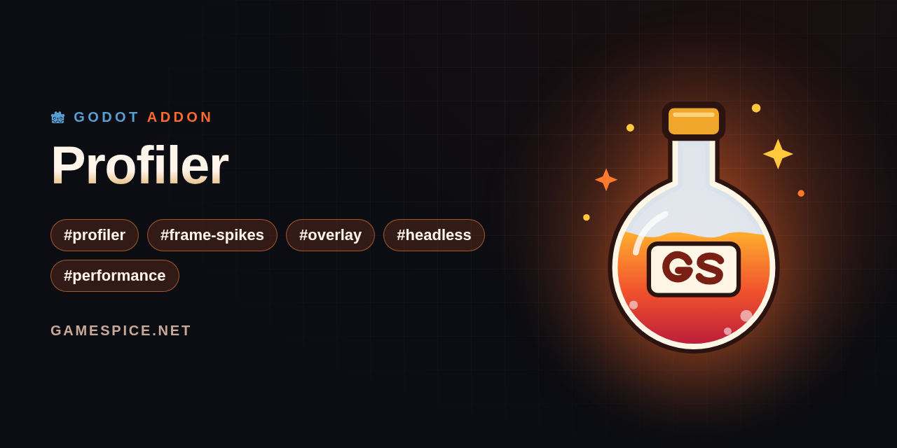

[](https://moddingcommunity.com/a/122-gs-profiler)

Finds the cause of frame spikes. When a frame runs over budget it logs which system took the time and what that system was doing, names causes that repeat on a beat, draws an overlay of the top costs, and writes JSON and text reports. It can run headless for a nightly performance budget.

Depends on GameSpice Core only (`GSFrameCost`, `GSHitchLog`, `GSSpaceQuery`, API level 30 or later). GameSpice Console, GameSpice Menu, GameSpice Server and GameSpice Server Query are used when present.

## Use

```gdscript
var prof := GSProfiler.new()
prof.config = GSProfilerConfig.new()
add_child(prof)
prof.bind_console(console_local)   # profiler_* cvars, record 30, profiler_stop, profiler_report
```

Systems report their cost:

```gdscript
var t := GSFrameCost.now()
_rebuild_paths()
GSFrameCost.add(&"navigation.rebuild", t, "%d paths" % n)
```

A spike then logs a warning such as:

```
frame 41.2 ms over 33.0 ms budget: t=12.50s 41.2 ms  navigation.rebuild (52 paths)  [phys 1.0 script 38.1 render 1.5 wait 0.6] repeats every 0.50 s (7 of 7 gaps)
```

## Settings

Everything is off by default.

| Setting | Effect |
| --- | --- |
| `profiler_enabled 1` | Watch for spikes. |
| `profiler_overlay 1` | Draw the overlay. |
| `record 30` | Record 30 seconds to `user://profiles/<stamp>.json`, `.txt` and `.folded`. |
| `profiler_timeline 1` | Record every frame, spikes flagged with what ran in them. |
| `profiler_render_detail 1` | Texture and buffer memory, draw split, render CPU/GPU ms. |
| `profiler_groups bots:ai.bot` | Unit counts per frame and each system's cost per unit. |
| `profiler_census 1` | Node classes that grew. |
| `profiler_script_top 30` | GDScript functions by self time (run with `-d`). |
| `profiler_reference <path.json>` | Diff each written report against that file (`.diff.txt`). |
| `profiler_compare a.json b.json` | Diff two reports; one path is compared with the newest. |

`prof.enable_capture_key()` makes F10 start and stop a capture with the call tree, physics ticks, queries, engine monitors and worst frames. All settings: [docs/design.md](docs/design.md#configuration).

Every report starts with a `context` (OS, CPU, GPU, Godot build, window, tick rate, game commit, launch arguments, changed console variables). Add your own with `prof.add_context("game", func(): return {...})`, and native timers with `prof.add_recording_hook("native", begin, end)`. To compare files outside the game: `tools/profile_compare.py baseline.json new.json --diff` (ignores changes under a 5% noise floor).

## Dedicated server

`GSProfilerServer.new().install(prof)` adds admin-only commands to gs-server's console and RCON: `sv_profiler_record`, `sv_profiler_stop`, `sv_profiler_status`, and metric commands (frame, hitches, systems, memory, net, or all as one JSON line). Recordings go to `<log_directory>/profiles`.

## Docs

| File | Covers |
| --- | --- |
| [docs/design.md](docs/design.md) | The pieces, configuration and cvars, instrumenting a system. |
| [docs/report-format.md](docs/report-format.md) | Report JSON keys, call tree, folded stacks, compare. |
| [docs/perf-report.md](docs/perf-report.md) | The stable `perf-<stamp>.json` (schema v1.1): budget ids and addons, hitches, render with a labelled cost estimate, memory, network per class, signal fan-out, a baseline diff, loads; how a new game plugs in. |
| [docs/deep-mode.md](docs/deep-mode.md) | Native samples with perf. |
| [docs/runner.md](docs/runner.md) | The headless runner and its `PERF` line. |
| [docs/menu.md](docs/menu.md) | The settings menu's Performance section. |
| [docs/server.md](docs/server.md) | Server commands, cvars and query keys. |

## Testing

Run the scenes in `examples/` (`profiler_selftest`, `profiler_detail_selftest`, `profiler_context_selftest`, `profiler_perf_selftest`) headless with Godot, and `python3 tools/profile_compare_test.py` and `python3 tools/perf_report_check_test.py` and `python3 tools/perf_upload_test.py` for the compare, perf-report and Nightly upload tools. The headless budget runner is `addons/gs_profiler/tools/gs_profiler_run.tscn`; see [docs/runner.md](docs/runner.md).

## Used by

### Zee's Games

Zee's Games is a collection of games I made on GameSpice, for demonstration and for fun. They show what the platform can do, and they run on live servers you can join. Anybody can create games on GameSpice, and each addon is its own repository and can be used separately from the games and from the rest of GameSpice.

All fourteen games vendor it:

- [Fatal Contact](https://zeesgames.com/fatal-contact)
- [Airdrift](https://zeesgames.com/airdrift)
- [Playlot](https://zeesgames.com/playlot)
- [Hungario](https://zeesgames.com/hungario)
- [Buses From Hell](https://zeesgames.com/buses-from-hell)
- [Smash Copter](https://zeesgames.com/smash-copter)
- [Zombie Zone](https://zeesgames.com/zombie-zone)
- [Hide n Seek](https://zeesgames.com/hide-n-seek)
- [Prop Hunt](https://zeesgames.com/prop-hunt)
- [Murder Mystery](https://zeesgames.com/murder-mystery)
- [Deathrun](https://zeesgames.com/deathrun)
- [Wipeout](https://zeesgames.com/wipeout)
- [Dangerous Delivery](https://zeesgames.com/dangerous-delivery)
- [Look At Me](https://zeesgames.com/look-at-me)

The whole collection is at [zeesgames.com](https://zeesgames.com).

## Status and licence

Part of the [**GameSpice**](https://gamespice.net) platform: a family of Godot addons, MIT licensed and built with Claude Code. The headless scenes are `profiler_selftest` and its siblings under Testing. Games in [Zee's Games](https://zeesgames.com) are built on GameSpice addons and run on live servers, and this profiler is how their frame spikes are found. Report bugs on the [issue tracker](https://github.com/gamespice-platform/profiler/issues).

MIT licence, see [LICENSE](LICENSE). The only closed part of the [**GameSpice**](https://gamespice.net) platform is the web back end; you can use your own instead of GameSpice's.
